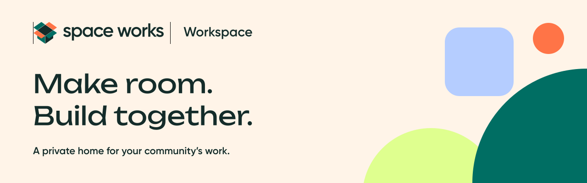
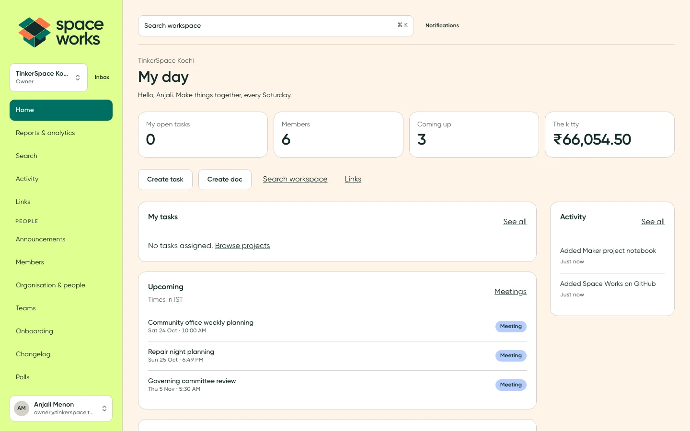
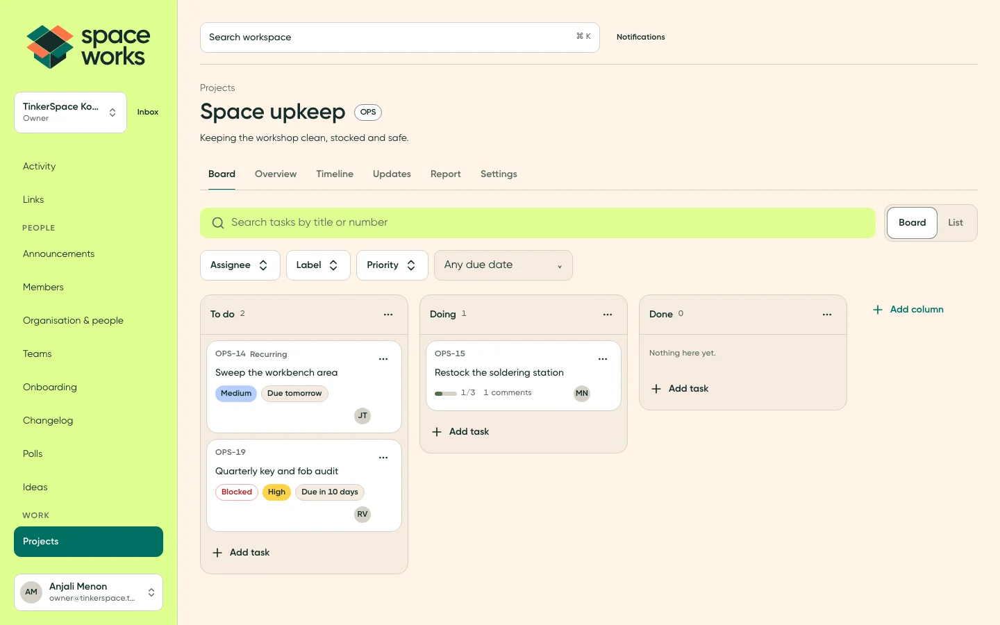
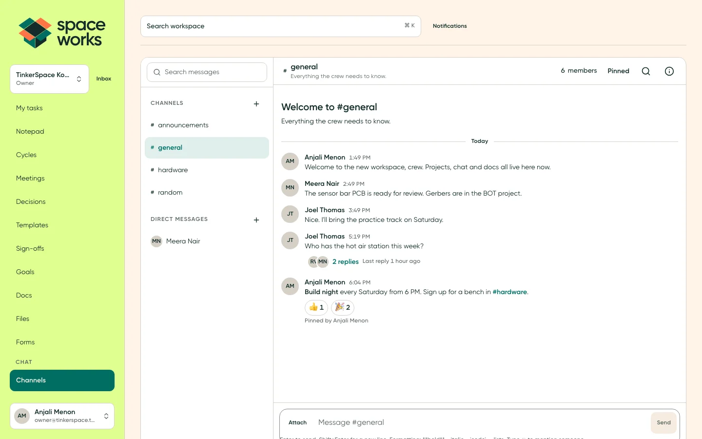
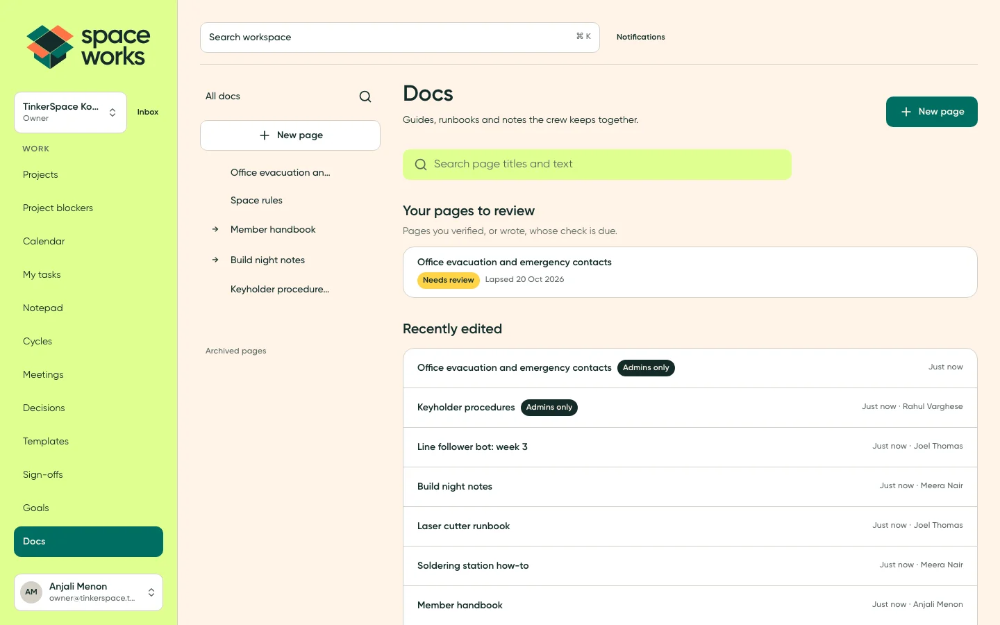
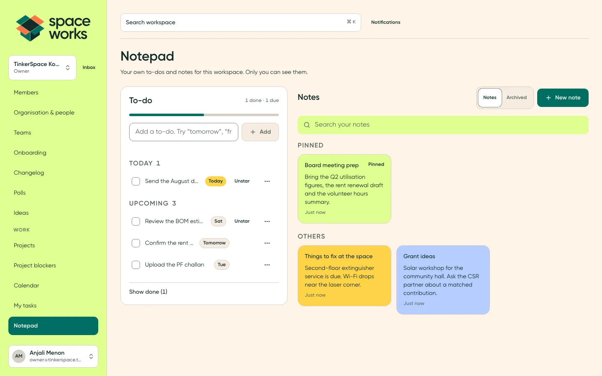
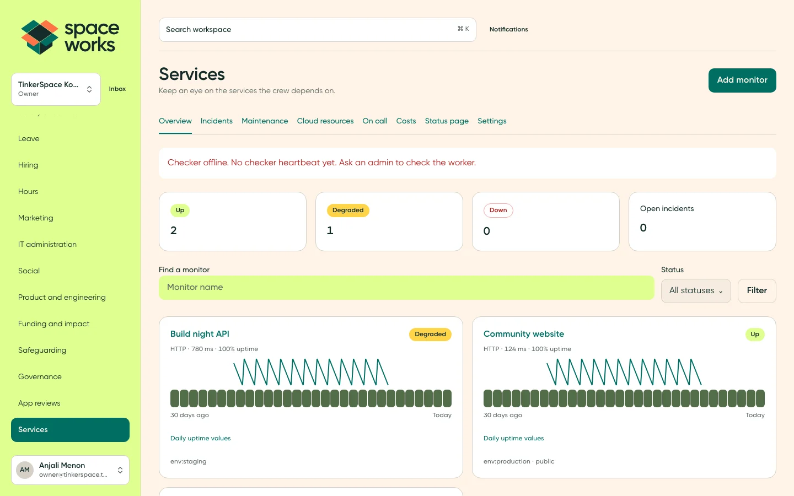
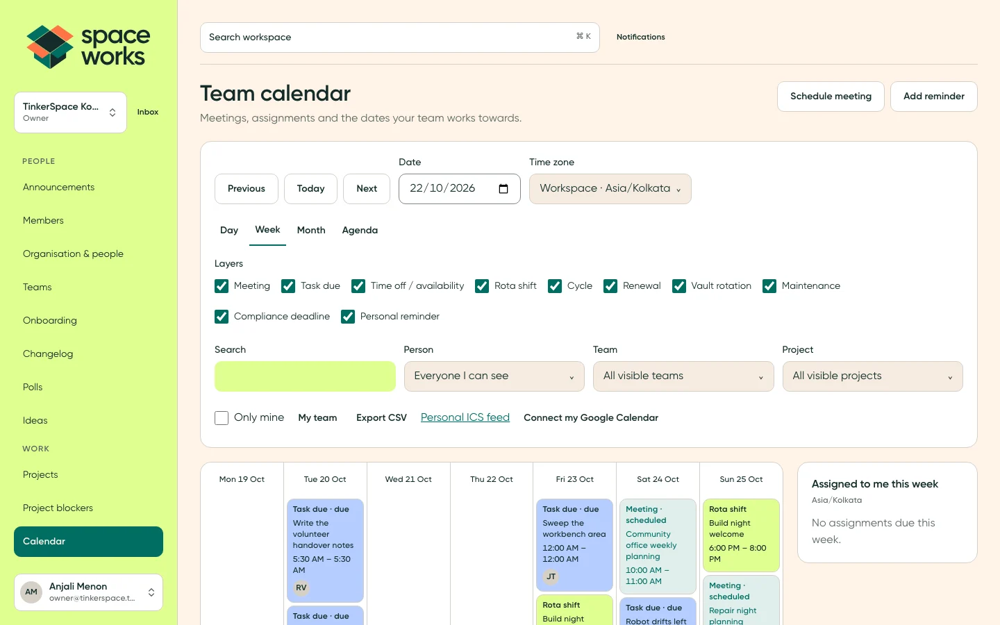
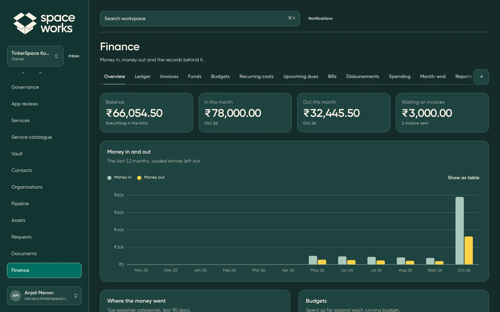
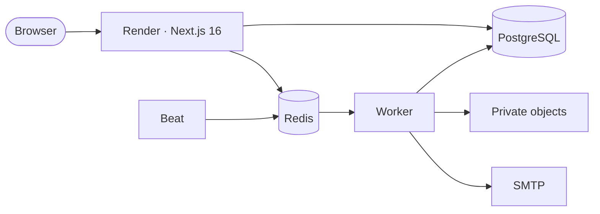

<picture>
  <source media="(prefers-color-scheme: dark)" srcset="docs/readme/banner-dark.png" />
  <source media="(prefers-color-scheme: light)" srcset="docs/readme/banner.png" />
  
</picture>

<p align="center">
  <a href="LICENSE"></a>
  <a href="https://nextjs.org"></a>
  <a href="docs/DEVELOPMENT.md"></a>
  <a href="docs/DEPLOYMENT_VPS.md"></a>
</p>

<p align="center">
  <a href="#host-it-on-a-vps-with-docker">Host on a VPS</a> ·
  <a href="#run-it-for-free">Free cloud hosting</a> ·
  <a href="#quick-start-local">Quick start</a> ·
  <a href="docs/README.md">Documentation</a> ·
  <a href="CONTRIBUTING.md">Contributing</a> ·
  <a href="#credits">Credits</a>
</p>

**Space Works Workspace is the free, open-source, invite-only home for your
community team.** Plan builds, talk, keep shared knowledge, look after people,
track the kitty and run your services in one self-hosted workspace. It started
with the Space Works maker community at TinkerSpace Kochi. Your members, files
and conversations stay in infrastructure you control, with separate workspaces,
roles and an audit trail.

## What you can do

Grouped the way a community team works.

### Work

- Projects and kanban boards, task assignees, labels, priorities, checklists, comments and short task links.
- Recurring tasks, dependencies, cycles, personal tasks and saved views.
- Meetings with agendas, decisions and action items; goals, key results and check-ins.
- Polls, ideas and votes, reusable templates, changelog drafts and lightweight sign-offs.

### Chat and knowledge

- Public and private channels, direct messages, threads, reactions, pins, mentions and live updates.
- Nested rich-text docs, revisions, restore, verification, export and presence.
- Private files, versions, folders, controlled downloads and a workspace link library.
- Global search and a keyboard command palette with live permission checks.

### Community and people

- Announcements, shoutouts, community events, RSVPs, waitlists and calendar subscriptions.
- Member profiles and skills, private teams, onboarding checklists and certifications.
- Availability, rota and shift swaps; contacts, organisations, interactions and a relationship pipeline.
- My day, recent activity, bookmarks and notifications that follow each member's access.

### Operations and money

- The community kitty, income and expenses, categories, receipts, CSV import/export and invoices.
- Budgets, purchases, reimbursements and approval policies with discussion and decision history.
- A service catalogue and dependencies, subscriptions, ownership and renewal reminders.
- An encrypted vault with grants, fresh-MFA reveal, rotation and access logs.
- Equipment inventory, QR labels, bookings, checkouts and maintenance records.
- Forms and submissions, controlled exports, imports, retention policies and legal hold.
- A public blog with drafts, previews, publishing, feeds and private cover delivery.

### Services monitor

- HTTP, TCP, DNS, TLS, database, heartbeat and other service checks with incident history.
- Incidents, maintenance, on-call schedules, escalations and public status pages.
- Cloud accounts, inventory, metrics, costs and budgets, including VPS providers.
- Service relationships and task follow-ups for incident work.

### Integrations and messaging

- Google Calendar, Gmail, Drive and Search Console; GitHub App repositories, issues and pull requests.
- Slack, Discord, Mattermost, Telegram and WhatsApp connections, verified account linking and channel bridges.
- Notification rules, destinations, quiet hours, snooze, mutes and personal digests.
- Signed webhooks, scoped machine APIs and MCP tools for approved integrations.

### App reviews

- Apple App Store and Google Play review inboxes, replies, translation, assignment and tags.
- Rating and response insights, task links and Slack-assisted replies with explicit member mapping.

### Space Works Assistant

- Conversations with permission-checked workspace tools, memory, skills and scheduled jobs.
- A boardroom for several assistant perspectives, summaries and follow-up work.
- Optional provider keys configured by the instance admin; access stays scoped to the signed-in member.

### Notepad

- Private notes with rich text, checklists, colours, pinning and archive.
- Personal to-dos, due days, stars, ordering and sending a to-do to workspace tasks.
- Notes remain private to their author, including from workspace admins.

### Run it safely

- Strict workspace isolation and OWNER, ADMIN, MEMBER and GUEST roles.
- Invite-only membership, password and optional Google/OIDC sign-in, MFA and session revocation.
- Super-admin controls behind a fresh TOTP step-up; audit, rate limits, CSP nonces and private storage.
- Personal account export, controlled tenant exports, accessible controls and light/dark modes.
- Two release images, guided VPS operations, encrypted off-site backups and deliberate recovery.

See the [area guides](docs/README.md#feature-areas) for implemented contracts and limits.

## A look around

Screenshots of every area arrive with the 0.6.5 release.

<!-- Restored by the release screenshot capture (scripts/capture-readme-screens.mjs).
<table>
  <tr>
    <td width="50%" valign="top"><p><strong>My day.</strong> Tasks, upcoming plans, announcements and recent activity.</p></td>
    <td width="50%" valign="top"><p><strong>Project board.</strong> Keep the next build moving.</p></td>
  </tr>
  <tr>
    <td width="50%" valign="top"><p><strong>Chat.</strong> Channels, threads and the crew’s conversations.</p></td>
    <td width="50%" valign="top"><p><strong>Docs.</strong> Shared knowledge with history and controlled access.</p></td>
  </tr>
  <tr>
    <td width="50%" valign="top"><p><strong>Notepad.</strong> Your private notes and to-dos.</p></td>
    <td width="50%" valign="top"><p><strong>Services.</strong> Checks, incidents and uptime in one place.</p></td>
  </tr>
  <tr>
    <td width="50%" valign="top"><p><strong>App reviews.</strong> Triage and reply to store feedback.</p></td>
    <td width="50%" valign="top"><p><strong>Assistant.</strong> Ask about the work you can access.</p></td>
  </tr>
  <tr>
    <td width="50%" valign="top"><p><strong>Calendar.</strong> Events, meetings and shifts together.</p></td>
    <td width="50%" valign="top"><p><strong>Finance, dark mode.</strong> The kitty, invoices and recent expenses.</p></td>
  </tr>
</table>
-->

## Host it on a VPS with Docker

**Yes — the complete application runs on your own VPS, installed with one line.**
It ships as a **backend** image (the API, which also runs the
database migrations and operator tools) and a **frontend** image (the website).
The production Docker Compose stack runs them with **PostgreSQL 16**,
**Redis 7**, private **[Silo](https://github.com/pgsty/silo)** object storage (the
maintained, S3-compatible fork of the archived MinIO) for private documents and files,
automatic public HTTPS with Caddy, database migrations, a BullMQ worker and
beat for scheduled jobs. Only a domain and an authenticated SMTP relay are external; Render,
Supabase, Upstash and Cloudflare are optional hosting choices.

### Install in one line

On a 64-bit Linux server (Ubuntu/Debian, Fedora/RHEL/Alma/Rocky, Arch or openSUSE),
as root or a user with `sudo`:

```bash
curl -fsSL https://raw.githubusercontent.com/SpaceWorks-HQ/SpaceWorks-Workspace/main/install.sh | bash
```

It checks the server, picks the latest [release](https://github.com/SpaceWorks-HQ/SpaceWorks-Workspace/releases)
and asks every question first: the layout (by default the website and API
containers both on this VPS, at `workspace.example.com` and `api.workspace.example.com`;
or one app container on one hostname; or the website on Netlify), hostnames, the
super-admin email, HTTPS (automatic Let's Encrypt, a LAN/trial certificate, or
your existing reverse proxy), file storage (bundled Silo or an external S3/R2
bucket), your SMTP relay (Brevo is prefilled on port 2525) and whether to set up
automatic deploys. Invalid answers are asked again. One summary lists every choice and host
change, and **nothing changes until you confirm it**. Then it installs Docker if
needed, generates every secret and internal TLS certificate without printing them,
downloads the release's ready-made images from
[GitHub Packages](docs/CONTAINER_IMAGES.md) (amd64 and arm64), migrates and
checks that each service is healthy. Nothing is compiled on your server.

**Before you start:** 2 vCPU, 2 GB RAM and 30 GB SSD for a small instance, DNS A
records pointing at the server (two for the default layout), inbound ports 80 and 443, an SMTP
relay on a verified sending domain, and your super-admin email.

### Update, back up and check

Run the same command again. An existing installation shows a menu:

1. **Update to the latest release** — backs up the database and configuration,
   downloads the new images while the site keeps running, migrates and restarts. If
   the new release is not healthy, the previous one is restored automatically.
2. **Back up now** — database, configuration and uploaded files, into
   `/etc/spaceworks-workspace/backups/`.
3. **Check status and health** — services, disk, newest backup and live checks.
4. **Backups** — nightly schedule, retention, encryption to a key you keep off the
   server (`age`), and copies to an off-site S3 bucket. Check backup freshness from the installer status command.
5. **Change settings** — hostnames, outgoing email (SMTP) or bucket credentials;
   rolled back automatically if the checks fail.
6. **Server security** — a firewall allowing only SSH, HTTP and HTTPS, automatic
   security updates and fail2ban.
7. **Automatic deploys** — install (or remove) a GitHub Actions runner so every
   published release updates the server by itself, when each release is published.
8. **Recover super-admin access** — for a lost authenticator or password: resets
   MFA and prints a one-hour reset link.
9. **Support bundle** — checks and recent logs with secrets redacted.
10. **Uninstall** — keeps the data, secrets and backups unless you type `DELETE DATA`.

`0` (the default) cancels without changing anything.

The internal service certificates renew themselves before they expire (a weekly
systemd check), and setup asks about backups and hardening up front.

Releases live in `/opt/spaceworks-workspace/releases/<commit>` with `current` pointing
at the running one; secrets stay in `/etc/spaceworks-workspace`. Options: `--release`
for a specific release, `--ref` to build a branch or commit from source (needs
4 GB of memory), `--repo` for a fork, `--dir` for another location and `--update`
to skip the menu; `bash install.sh --help` lists them. A new release is published
by the first `main` build of each new `VERSION`. A restore is a
deliberate step: `sudo bash /opt/spaceworks-workspace/current/scripts/vps-restore.sh <backup>`.

The installer does not change DNS or provision SMTP. The
**[complete VPS guide](docs/DEPLOYMENT_VPS.md)** covers manual
installation from a checkout, updates, rollback, backups and restores, internal
certificate renewal and monitoring. Use `compose.production.yml`; the development
and staging Compose files are not production setups.

### Netlify + VPS

Choose **3** in the installer to render the shared Next.js UI on Netlify while
authentication, tenant data, files, jobs and actions stay on the VPS. Browser
APIs use the frontend origin; authenticated realtime streams go directly to the
backend with short-lived, one-use tickets. The default VPS layout uses the same
`frontend/` workspace in a container.

Copy the generated `frontend.env` values to Netlify, set **Package directory =
frontend**, keep **Base directory = repository root**, and use
`frontend/netlify.toml`. Deploy the same source revision on both hosts. The
frontend holds only URLs, a private gateway credential and its own action key.
Follow [Netlify + VPS](docs/DEPLOYMENT_SPLIT.md).

Private repositories and packages can use `SWW_GITHUB_TOKEN`; public installs
need nothing. See [private installs](docs/DEPLOYMENT_VPS.md#private-repositories-and-packages).

## Cloud hosting

The [Render Blueprint](render.yaml) runs web, worker and beat on paid compute,
with managed PostgreSQL, persistent native Redis and private object storage.
A free web plan needs an independently hosted worker; Cloudflare cron can
replace beat by calling the two enqueue endpoints every minute. Worker handles
email, notifications, scheduled jobs, syncs and monitor checks.



[Deploy to Render](https://render.com/deploy?repo=https://github.com/SpaceWorks-HQ/SpaceWorks-Workspace).
The [cloud guide](docs/DEPLOYMENT_CLOUD.md) covers secrets, TLS, SMTP, workers,
first-run setup and free-plan limits. [Jobs operations](docs/areas/jobs-queue.md)
covers retries, health and recovery. Docker, AWS, DigitalOcean and Kubernetes
remain supported alternatives.

## Quick start (local)

Use Node.js 22 and PostgreSQL 16. The development Compose file provides the database.

```bash
npm ci
cp .env.example .env
docker compose up -d
npm run db:deploy
DEMO_PASSWORD='choose-12-or-more-characters' npm run db:seed:demo
npm run dev -- --port 3290
```

Set `AUTH_URL` and `NEXT_PUBLIC_BASE_URL` in your local configuration to
`http://localhost:3290`. Open that address and sign in as
`owner@tinkerspace.test` with your demo password. The seed creates a community
workspace and loads every module in `scripts/seed/`. Redis, SMTP and S3 have
development fallbacks; configure real services for production. See
[Local development](docs/DEVELOPMENT.md).

## Design system

Gilroy, flat cards, teal actions, a Citron sidebar and one bold accent moment.

| | Colour | Used for |
| --- | --- | --- |
|  | Deep Ink | Text and dark surfaces |
|  | Warm Cream | Canvas and inverse labels |
|  | Maker Teal | Actions, links and focus |
|  | Workshop Orange | Accent fill with an ink label |
|  | Citron | Sidebar and selection |
|  | Sky Blue | Information |
|  | Warm Yellow | Warnings |

Read [the design guide](docs/DESIGN.md). Regenerate the banners and swatches with
`npm run readme:art`. Screenshots are captured by an operator with
`DEMO_PASSWORD=... node scripts/capture-readme-screens.mjs http://localhost:3290`.

## Documentation

| Read this | When you want to |
| --- | --- |
| [Documentation index](docs/README.md) | Find feature areas and engineering guides |
| [Architecture](docs/ARCHITECTURE.md) | Understand tenancy, services and background work |
| [Configuration](docs/CONFIGURATION.md) | Look up settings and secrets |
| [VPS deployment](docs/DEPLOYMENT_VPS.md) | Install, update, back up and recover |
| [Netlify + VPS](docs/DEPLOYMENT_SPLIT.md) | Split frontend rendering and backend services |
| [Container images](docs/CONTAINER_IMAGES.md) | Understand VERSION, tags and GitHub Packages |
| [Cloud deployment](docs/DEPLOYMENT_CLOUD.md) | Use managed services and free plans |
| [Release procedure](docs/PRODUCTION_RELEASE.md) and [operations](docs/production-operations.md) | Ship and run it |

## Contributing

Read [CONTRIBUTING.md](CONTRIBUTING.md), [AGENTS.md](AGENTS.md) and the area guide
before making a change. Features branch from `dev`; `main` is production. Include
validation and update the relevant docs with behavior changes. Keep tenant and
role checks on the server, and keep credentials out of issues and logs.

## Credits

Made by **Space Works**, a maker community that started inside TinkerSpace Kochi.
The Space Works brand, design and community guide the product. Thanks to the
maintainers of the open-source technologies it runs on.

Licensed [AGPL-3.0-or-later](LICENSE). If you modify and host it, offer the matching
source to the people using your version.
